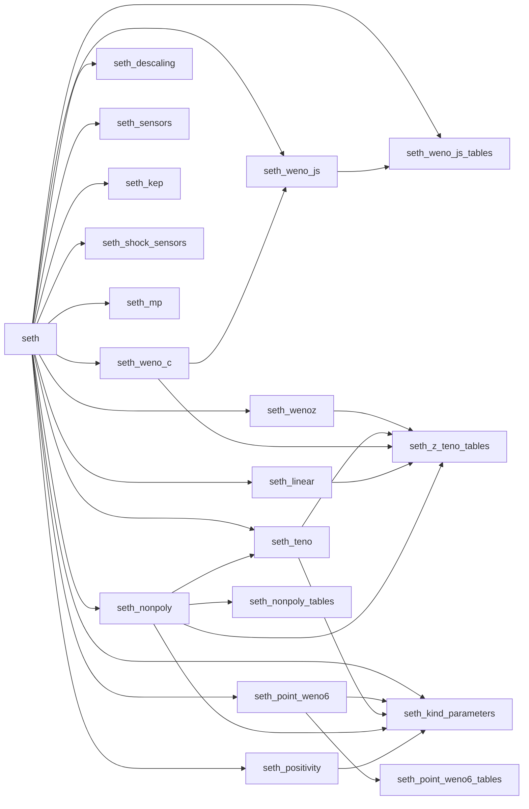

# Reference

Every public name of SETH, family by family. `use seth` gives all of them: the kernels, their constants and the
kinds `I4P`, `I8P`, `R4P`, `R8P` and `R_P` (from PENF). Each kernel's page gives its call, the bounds of its arrays,
its order, its parameters with their recommended constants, and a link to the [API](/api/) page that formal
generates from the source comments.

## What every kernel shares

- **One face per call.** A kernel computes the states at the face $x_{i+1/2}$ from the cells around it, indexed by
  their offset from the face: cell 0 left of it, cell 1 right of it ([Conventions](/guide/conventions)).
- **Two stencils.** `vp` is read with a left bias and gives the left state `rp`; `vm` is read with a right bias and
  gives the right state `rm`. Pass the same array twice for the two states of one field; pass $f^+$ and $f^-$ of a
  flux splitting for a flux, `rp + rm`.
- **No setup, no state.** The coefficients are compile-time constants. Every kernel is `pure`, `!$acc routine seq`
  and `!$omp declare target`: call it inside your own loops, on the host or on a GPU.
- **One real kind**, `R_P`, fixed when the library is built: R8P by default, R4P with the `*-r4` modes
  ([Kinds and constants](./kinds)).

## Feature map

| Area | Names | Page |
|---|---|---|
| WENO-JS reconstruction and interpolation, orders 1 to 9 | `seth_weno{1,3,5,7,9}_js`, `_wr`, `_interp`, `_interp_wr`; `SETH_WENO_JS_EPS` | [WENO-JS](./weno-js) |
| Descalers of the smoothness indicators | `seth_weno_descaling`, `seth_weno_descaling_ai`; `WENO{1,3,5,7,9}_JS_D_SCALE` | [WENO-JS](./weno-js#descalers) |
| WENO-Z, orders 3 to 9 | `seth_wenoz{3,5,7,9}`, `_interp` | [WENO-Z](./weno-z) |
| TENO, 5 to 8 points | `seth_teno5`, `seth_teno5_opt`, `seth_teno5_az`, `seth_teno5_a`, `seth_teno6`, `seth_teno6_opt`, `seth_teno6_neno6`, `seth_teno8`, `seth_teno8_a`, `seth_teno{5,6}_interp`; `SETH_TENO_EPS`, `SETH_TENO*_CT`, `SETH_TENO{5,8}_A_*` | [TENO](./teno) |
| Centred WENO, orders 4 to 8 | `seth_weno{4,6,8}_c` | [Centred WENO](./weno-c) |
| WENO-6 interpolation of six point values at an off-node point (ADAM's AMR seam transfer) | `seth_weno6_point`, `seth_weno6_jumps`; `SETH_WENO6_JUMP_RATIO`, `SETH_WENO6_EPS` | [WENO-6 point interpolation](./weno6-point) |
| Non-polynomial TENO: DR, THINC, stencil targeting, Gaussian RBF | `seth_teno5_dr`, `seth_teno5_thinc`, `seth_teno5_st`, `seth_teno5_rbf`, `seth_teno5_rbf_dr`; the pieces `seth_teno5_mask`, `seth_teno5_zeta`, `seth_dr_detect`, `seth_thinc_detect`, `seth_dr_override`, `seth_thinc_override`; `SETH_DR_T1`, `SETH_DR_T2`, `SETH_THINC_BETA`, `SETH_RBF_*`, `SETH_NONPOLY_GUARD` | [Non-polynomial TENO](./nonpolynomial) |
| Linear schemes, the smooth branch of a hybrid | `seth_linear{3,5,7,9,6,8}`, `seth_linear{3,5,7,9,6}_interp` | [Linear](./linear) |
| Smoothness sensors | `seth_sensor_teno`, `seth_sensor_teno_eps`, `seth_sensor_ren`, `seth_sensor_lcr`, `seth_sensor_tau`; `SETH_SENSOR_*` | [Sensors](./sensors) |
| Central fluxes and shock sensors | `seth_keep_pe{2,4,6,8}`, `seth_keep_pe8_opt`; `seth_ducros`, `seth_ducros_compression` | [Central fluxes](./central) |
| Limiters | `seth_mp_bound`, `SETH_MP_ALPHA`; `seth_positivity_euler`, `seth_euler_admissible`, `SETH_POSITIVITY_EPS`, `SETH_POSITIVITY_NV_MAX` | [Limiters](./limiters) |
| Kinds and the build's precision | `I4P`, `I8P`, `R4P`, `R8P`, `R_P`; the modules `seth_kind_parameters`, `seth_weno_js_tables`, `seth_z_teno_tables`, `seth_nonpoly_tables`, `seth_point_weno6_tables` | [Kinds and constants](./kinds) |

## Every kernel at a glance

| Kernel | Bounds of `vp`, `vm` | Order on smooth data | Parameters after `vp, vm` |
|---|---|---|---|
| `seth_weno1_js` | `0:1` | 1 | `eps, rmu` |
| `seth_weno3_js` | `-1:2` | 3 | `eps, rmu` |
| `seth_weno5_js` | `-2:3` | 5 | `eps, rmu` |
| `seth_weno7_js` | `-3:4` | 7 | `eps, rmu` |
| `seth_weno9_js` | `-4:5` | 9 | `eps, rmu` |
| `seth_wenoz3`, `5`, `7`, `9` | `1-S:S`, $S = 2..5$ | 3, 5, 7, 9 | `eps, p` |
| `seth_teno5`, `seth_teno5_az` | `-2:3` | 5 | `eps, ct` (AZ: `eps, ct, rmu`) |
| `seth_teno5_opt` | `-2:3` | 4 | `eps, ct` |
| `seth_teno5_a` | `-2:3` | 5 | `eps, cr, xi, a1, a2, rmu` |
| `seth_teno6` | `-2:3` | 6 | `eps, ct` |
| `seth_teno6_opt` | `-2:3` | 5 | `eps, ct` |
| `seth_teno6_neno6` | `-2:3` | 4 | `eps, ct` |
| `seth_teno8` | `-3:4` | 6 | `eps, ct` |
| `seth_teno8_a` | `-3:4` | 6 | `eps, cr, xi, a1, a2, rmu` |
| `seth_weno4_c`, `6_c`, `8_c` | `-1:2`, `-2:3`, `-3:4` | 4, 6, 8 | `eps, rmu` |
| `seth_teno5_st`, `seth_teno5_rbf` | `-2:3` | 5 | `eps, ct` (RBF: `eps, ct, cr, s1, s2`) |
| `seth_teno5_dr`, `seth_teno5_thinc`, `seth_teno5_rbf_dr` | `-5:6` | 5 | see [Non-polynomial TENO](./nonpolynomial) |
| `seth_linear3`, `5`, `7`, `9` | `1-S:S` | 3, 5, 7, 9 | none |
| `seth_linear6`, `seth_linear8` | `-2:3`, `-3:4` | 6, 6 | none |

Every kernel above ends with `rp, rm`; the `_wr` kernels add `wrp, wrm`. The `_interp` kernels take the arguments of
their reconstruction twin. Measured orders: [A1](/verification/accuracy/order-of-accuracy).

The one kernel that is not a face kernel, `seth_weno6_point(u, t4)`, returns the value of six point values `u(1:6)`
at $x = t_4/4$ (node $k$ at $x = k$), of order 6, 5 or 4 by the target
([WENO-6 point interpolation](./weno6-point)).

## Modules

`seth` re-exports the public names of its modules; a program needs only `use seth`.

Every module also uses PENF, for the kinds. The table modules hold every coefficient as a named constant
([Kinds and constants](./kinds#coefficient-tables)).
