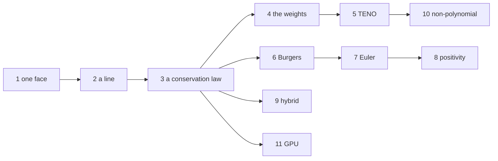

# Tutorial

Chapters that take you from the two states at one face to a solver of the Euler equations that survives blast waves. Each chapter is a
complete program in `docs/examples/src/`. The code on these pages is that program, and the output is what it printed
when the documentation was built (`bash scripts/docs_examples.sh` regenerates both, and CI fails when they drift).

The time step: chapter 3 writes its SSP-RK3 by hand, three lines, to show what a step is. Chapters 6 to 10 and the
cookbook take it from [SELAH](https://szaghi.github.io/SELAH/), its `SCHEME_SSP_33` driven stage by stage around
SETH's residual, as a solver built on SETH does: SETH is a source of space operators, SELAH of the time operators.
Chapter 11, on the GPU, keeps its own step until it is wired to SELAH's device build.



| Chapter | You learn |
|---|---|
| [1. One face by hand](./01-face) | what a kernel computes: `vp`, `vm`, the two states `rp`, `rm`, the weights ratios, the mirror |
| [2. A line of faces](./02-line) | a periodic grid, ghost cells, the face loop, and the order of accuracy it gives |
| [3. A conservation law](./03-advection) | finite volumes: flux splitting, face fluxes, SSP-RK3; what the nonlinear weights buy |
| [4. The weights](./04-weights) | `eps` and the descaler `rmu`: small data, and a small jump on a large offset |
| [5. TENO and its cutoff](./05-teno) | where TENO is exactly linear, what the cutoff decides, and critical points |
| [6. A nonlinear flux](./06-burgers) | Burgers' equation: the splitting's $\alpha$, a shock without oscillations |
| [7. A system](./07-euler) | the Euler equations: characteristic variables, and why component-wise oscillates |
| [8. Positivity](./08-positivity) | the positivity-preserving flux limiter on the Woodward–Colella blast waves |
| [9. A hybrid](./09-hybrid) | a sensor per face: the linear scheme where smooth, TENO5 elsewhere |
| [10. Non-polynomial TENO](./10-nonpoly) | the DR and THINC overrides: a jump kept within two or three cells |
| [11. On the GPU](./11-gpu) | the solver's loops on the device with OpenACC, the kernels unchanged |

## Building the examples

Every program is compiled the way your own program would be, against the static library that FoBiS builds, which
carries PENF:

```bash
fobis fetch                       # PENF into src/third_party
fobis build --mode static-gnu     # lib/gnu/static/libseth.a and its modules
gfortran -I lib/gnu/static/mod docs/examples/src/t01_face.F90 lib/gnu/static/libseth.a -o t01_face
./t01_face
```

`bash scripts/docs_examples.sh` does this for every program and regenerates the snippets and outputs these pages
include.
